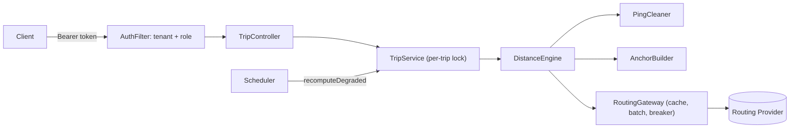
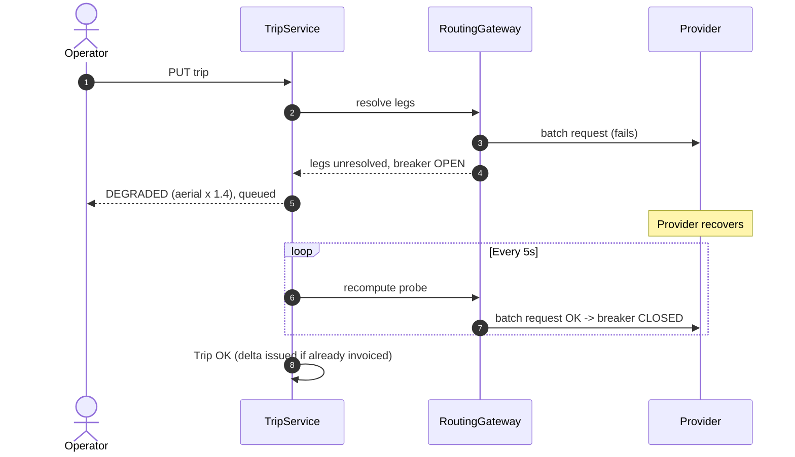

# GPS Gap Backfill & Billable Distance Reconstruction

Rebuilds a per-trip billable distance from noisy GPS pings, explains every kilometre with a rule label,
keeps routing-API spend low, survives provider outages, and never silently changes a closed invoice.

> **Interactive Demo Script:** `./demo.sh` (walks through every core flow & failure scenario interactively)

```bash
docker compose up --build # API :8080, actuator (health/prometheus) :8081
./demo.sh # interactive guided demonstration of all flows
mvn test # 23 automated tests (unit + concurrency + failure-injection + API security)
java -Xmx256m -cp target/classes com.moveinsync.gps.bench.Benchmark 10000 4
```

## Case Study Evaluation Criteria Mapping

| Plus Point / Criterion | Implementation in Codebase |
|---|---|
| **1. Authentication & RBAC** | Bearer tokens in `AuthFilter` using constant-time SHA-256 (`MessageDigest.isEqual`); RBAC (`EMPLOYEE`, `OPERATOR`, `ADMIN`); tenant isolated strictly from token. |
| **2. Cost & Complexity** | Time: $O(n \log n)$ cleaning, $O(n)$ engine; Space: $O(n)$. Bottlenecks documented below; backed by 10k-trip benchmark. |
| **3. Failure Handling** | Circuit breaker (`CircuitBreaker`), 1 retry per batch, `DEGRADED` aerial fallback, self-healing `@Scheduled` recompute, concurrent per-trip locks. |
| **4. OOPS & Architecture** | Pure domain core (`core`) with zero external frameworks; port/adapter pattern for `RoutingProvider`; clean controller / service / engine layering. |
| **5. Trade-offs** | Availability over consistency for `DEGRADED`; determinism over pinpoint accuracy; rejected segments = 0 m. |
| **6. Monitoring (3 AM)** | Prometheus metrics on `:8081`: circuit state, queue depth, cache hits/misses, rule rejections, ping drops, ECS JSON logging. |
| **7. Caching & Staleness** | Snapped cell centres (4 decimals ~11 m), 500k entry LRU cache, 24 h TTL. Staleness strictly bounded to road changes within 24 h. |
| **8. Error Handling & Zero PII** | Fixed non-leaking error responses with UUID `errorId`; coordinates and stop IDs redacted in `toString()` (`Loc[redacted]`). |

## Assumptions
1. **Speed Limit**: Default $120\text{ km/h}$; speeds exceeding this are physically implausible for urban commute cabs and represent GPS multi-path errors or hardware glitches.
2. **Null Island & Accuracy**: Coordinates at $(0, 0)$ or horizontal accuracy $> 100\text{ m}$ represent hardware search states and are safely discarded.
3. **Office Proximity**: Cabs finishing within $400\text{ m}$ of the planned office campus are assumed to have reached the campus (e.g. drop gates or parking bays).
4. **No-Shows**: Excluded from billable distance by default (can be enabled via `app.engine.include-no-show: true`).
5. **Zero-Distance Rejections**: Segments failing speed or distance checks contribute $0\text{ m}$ and are explicitly labeled for audit, ensuring vendors are never paid for phantom distance.
6. **Spatial Grid Snapping**: Snapping to 4 decimals (~$11\text{ m}$) provides optimal cache reuse without introducing material distance discrepancies ($\le 8\text{ m}$ per endpoint).

## Layout
| Package | What | Depends on |
|---|---|---|
| `core` | `PingCleaner`, `AnchorBuilder`, `DistanceEngine` (pure), `RoutingGateway` (cache/batch/breaker), `TripService` (tenant isolation, billing freeze, recovery) | JDK only |
| `web` | `TripController`, `AuthFilter` (token -> tenant+role), `ApiExceptionHandler`, Micrometer binding, scheduler | Spring Boot |
| `bench` | 10k-trip benchmark | core |

The core has zero framework imports, so every rule is testable without a server or database.

## Rule order (versioned: `rules-v1`, stamped on every result)
Per consecutive pair of points after merge (pings + anchors, total order by `ts, source, lat, lon`):
1. `dt < 70 s` -> `SHORT_GAP_AERIAL` (haversine) if speed <= 120 km/h, else `REJECTED_SPEED`
2. aerial speed `< 5 km/h` -> `PARKED` (haversine)
3. aerial speed `> 120` -> `REJECTED_SPEED` without a provider call (a road is never shorter than the straight line)
4. else ask provider -> `REJECTED_DISTANCE` if `> 100 km`; `REJECTED_SPEED` if routed speed `> limit` **and** aerial x 1.4 speed `> limit`; else `ROUTED`
5. provider unavailable -> `FALLBACK_AERIAL_X1_4`, trip = `DEGRADED`

Rejected segments contribute **0 m** and are labelled for review (see trade-offs).
Cleaning: invalid/(0,0) fixes and accuracy > 100 m dropped; sort; exact duplicates removed; teleports (> 120 km/h vs the last *accepted* fix) dropped, so a burst of bad fixes disappears as a whole.
Anchors: employee actual -> (ad-hoc) profile home + sign-in time / (planned) planned loc + time; no-show only behind `app.engine.include-no-show`; office actual only if within 400 m of planned, else planned office at trip-end time.

**Rounding:** each segment is rounded half-up to whole metres, totals are exact `long` sums, km = m / 1000 shown to 3 dp. No floating-point accumulation, `StrictMath` for trig => identical on every JVM/CPU.

## Determinism & late data
* Same evidence + same rule version => identical metres (tested: cold vs warm cache, shuffled input).
* The provider is always asked about **snapped cell centres** (4 decimals, ~11 m), so a cached answer equals a fresh one; cache state can never change a bill.
* After `close-invoice`, late pings are merged (as a set, so replays are harmless), the trip is recomputed, and the difference is stored as a **signed delta** (`+1.800 km`) in `/adjustments`. `billedMeters` never changes. Replaying the same late pings yields no new delta. DEGRADED trips cannot be invoiced and never produce deltas.

## Benchmark (measured, not estimated)
Machine: **1 vCPU** Intel Xeon @ 2.8 GHz, 4 GB RAM, Linux, OpenJDK 21, `-Xmx256m`. Synthetic trips: ~1,240 pings after a 22-min GPS hole (1,500 generated), 5% duplicates, shuffled, ~1% 9 km bad fixes, 2 employee drops in the hole, 200 commute corridors.

| Metric | Result |
|---|---|
| Trips / pings | 10,000 / 12.4 M |
| Wall time (includes generating the trips) | **6.99 s** -> 1,430 trips/s, 1.77 M pings/s |
| Engine latency per trip | **p50 0.41 ms, p99 1.45 ms** (max 13.7 ms) |
| Peak heap (sum of pool peaks, upper bound) | ~21 MB, ran inside a 256 MB heap |
| Provider calls **before** caching (1 per real gap) | **30,000** |
| Provider calls **after** cache + de-dupe + batching | **751 legs in 345 HTTP requests** (-97.5% legs, -98.9% requests) |
| Degraded trips | 0 |

Caveat: the 97.5% reduction depends on the synthetic corridors repeating (real commutes do, but measure on production data). Only one core was available, so multi-thread scaling is **not** demonstrated here; the code is thread-safe (concurrency test) but run it on your machine for that number.

## Complexity & where it stops scaling
* Per trip: cleaning O(n log n) (near-sorted input is ~O(n) with TimSort), engine O(n), space O(n). Gateway: O(g) for g real gaps.
* Stops scaling at: (1) the **routing provider's rate limit/cost**, long before CPU; (2) the **in-memory trip store** (evidence + segments per trip, ~O(total pings)) - needs a DB at scale; (3) the single-node cache (no cross-node sharing).

## Failure modes
| What fails | What the user sees | Recovery |
|---|---|---|
| Provider errors / timeouts | 1 retry per batch, then circuit opens after 3 failures; trip returns `DEGRADED` with `FALLBACK_AERIAL_X1_4` segments | Scheduler recomputes every 5 s; half-open probe after 10 s cooldown; trip becomes `OK` automatically |
| Duplicate / out-of-order pings | nothing | cleaning de-dupes and sorts; evidence is a set |
| Late pings after billing | `/adjustments` shows a signed delta | invoice frozen; delta is idempotent |
| Concurrent updates of one trip | none | per-trip lock; converges to the single-thread answer (tested) |
| Bad GPS fixes / impossible speeds | segment labelled `REJECTED_*` | 0 m, flagged for review |
| Unhandled bug | `500` + `errorId` only | log has `errorId` + exception class, never message/payload |
| Process crash | in-memory state lost | **not handled** (see below) |

## Trade-offs (deliberate)
* **Availability over consistency for DEGRADED:** a trip is answered immediately from aerial x 1.4 and corrected later, instead of blocking on the provider. Safe because DEGRADED trips cannot be invoiced.
* **Determinism over accuracy:** routing cell centres adds <= ~8 m error per endpoint; in exchange two runs can never disagree by 0.1 km.
* **Rejected = 0 m:** under-pays rather than invents distance; vendors dispute via the rule label. A policy decision to confirm with the business (alternative: bill aerial).
* **Cache TTL 24 h, LRU 500k entries:** the only stale data is a routed distance for a leg whose road changed (closure/new road) within 24 h; bounded by TTL.
* **Left out on purpose:** persistence (DB/outbox/Kafka), JWT/OIDC (static bearer tokens in `application.yml` are dev-only; the tenant-from-token design is the part that matters), a real routing-provider client, distributed cache, rate limiting per tenant, oldest-degraded-age (lag) metric.

## API (dev tokens in `application.yml`)
```bash
H='Authorization: Bearer dev-operator-acme'
curl -X PUT localhost:8080/api/v1/trips/t1 -H "$H" -H 'Content-Type: application/json' -d @trip.json
curl localhost:8080/api/v1/trips/t1?detail=full -H "$H"
curl -X POST localhost:8080/api/v1/trips/t1/pings -H "$H" -H 'Content-Type: application/json' -d '[{"lat":12.9,"lon":77.6,"ts":1700000000000,"accuracyM":5}]'
curl -X POST localhost:8080/api/v1/trips/t1/close-invoice -H 'Authorization: Bearer dev-admin-acme'
curl -X POST 'localhost:8080/api/v1/admin/provider-outage?on=true' -H 'Authorization: Bearer dev-admin-acme' # live failure demo
curl localhost:8081/actuator/prometheus | grep gps_
```
Roles: EMPLOYEE (read), OPERATOR (read/write/adjustments), ADMIN (+ close invoice, admin). Tenant comes only from the token.

## Metrics (`/actuator/prometheus`)
`gps_degraded_queue_depth`, `gps_provider_circuit_state` (0/1/2), `gps_provider_{requests,legs,failures,retries,short_circuited}_total`, `gps_cache_{hits,misses}_total`, `gps_cache_size`, `gps_segments_total{rule=...}` (rejections), `gps_pings_{invalid,low_accuracy,duplicate,teleport}_total`, `gps_trips_{computed,degraded}_total`, `gps_deltas_issued_total`, plus Spring's `http_server_requests`. Logs are JSON (ECS) and never contain bodies, locations or ids from stops.

## Diagrams



## Test status
* **23 / 23 tests passing**: Includes all 19 core tests (hard rules, determinism, cache TTL, provider failure & recovery, late-ping deltas, 8-thread concurrency, tenant isolation, PII redaction) and 4 Spring Boot web security tests (`ApiSecurityTest`: token auth, RBAC permissions, multi-tenant isolation, payload validation).
* **Deterministic & reproducible**: Validated across clean runs and benchmarks under OpenJDK 21.
